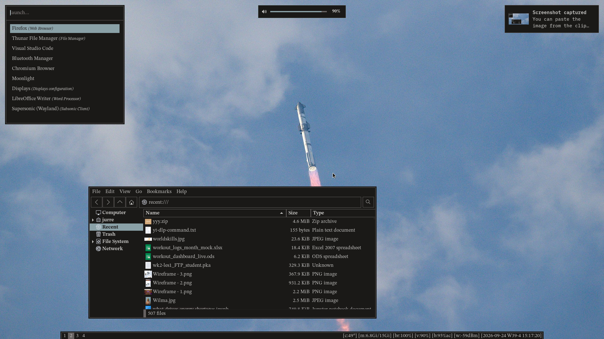

# Flatwork UI



Flatwork UI is the design platform: themes (tokens + design system + component library), a React component library, and a Nix flake with Home Manager modules for a precise dark Niri desktop (GTK, Firefox, Waybar, Rofi, Mako, SwayOSD, Alacritty, Fastfetch, and a Bash prompt).

| Theme | For | Contents |
| --- | --- | --- |
| [`hue-gradient-design`](./themes/hue-gradient-design) (default) | Desktop (Home Manager) | Nix tokens, design system, wallpaper |
| [`flatwork-saas`](./themes/flatwork-saas) | Web apps | `tokens.json`, design system, CSS component library, fonts |

React apps use [`@flatwork-ui/react`](./packages/react), which renders the component library's markup.

The visual direction of the default theme is documented in [`themes/hue-gradient-design/DESIGN.md`](./themes/hue-gradient-design/DESIGN.md): flat surfaces, no rounded corners, 1px structural borders, STIX Two Text for human/interface language, IBM Plex Mono for technical language, muted colors, and a restrained workstation feel.

## Themes

Each theme is one folder in `themes/`:

```
themes/<name>/
  default.nix    # entrypoint: tokens + design + components
  tokens.nix     # design tokens (desktop themes: the Nix schema; web themes: reads tokens.json)
  tokens.json    # web themes only: the token source shared with the JS build
  DESIGN.md      # the design system: the rules behind the tokens
  components/    # CSS component library (index.css + one file per component)
  fonts/         # web themes: self-hosted woff2
  wallpapers/    # desktop themes
```

Adding a folder is enough: the flake picks it up as `lib.themes.<name>` and `packages.<system>.theme-<name>`, and the React package builds a stylesheet for every theme with a `tokens.json`. Web themes are built by [`scripts/build-theme-css.mjs`](./scripts/build-theme-css.mjs) for both Nix and npm, so the two ship identical CSS.

Web component libraries share one contract: `fw-` prefixed classes, `--fw-*` variables, a `.fw` root with `data-theme="dark|light|system"`. A new theme that implements those classes works with the React components unchanged.

## Flake outputs

### Themes

```nix
flatwork-ui.lib.themes.default               # = hue-gradient-design
flatwork-ui.lib.themes.hue-gradient-design
flatwork-ui.lib.themes.flatwork-saas         # web tokens; not for the Home Manager modules
```

A theme attrset holds its tokens at the top level (`theme.colors`, `theme.fonts`, ...) plus `theme.design` (path to `DESIGN.md`) and `theme.components` (path to the component folder).

### Home Manager modules

Bundles:

```nix
flatwork-ui.homeManagerModules.default     # style + experience
flatwork-ui.homeManagerModules.style       # visual styling modules
flatwork-ui.homeManagerModules.experience  # full Firefox + Waybar experience
flatwork-ui.homeManagerModules.desktop     # GTK/Mako/Waybar/Rofi/SwayOSD
flatwork-ui.homeManagerModules.apps        # Alacritty/Firefox/Fastfetch/Bash prompt
```

Individual modules:

```nix
flatwork-ui.homeManagerModules.gtk
flatwork-ui.homeManagerModules.mako
flatwork-ui.homeManagerModules.waybar
flatwork-ui.homeManagerModules.rofi
flatwork-ui.homeManagerModules.swayosd
flatwork-ui.homeManagerModules.alacritty
flatwork-ui.homeManagerModules.firefox
flatwork-ui.homeManagerModules.fastfetch
flatwork-ui.homeManagerModules.bash-prompt
```

### NixOS modules

```nix
flatwork-ui.nixosModules.fonts
```

Installs the font set needed by the theme.

### Generated files

```nix
flatwork-ui.packages.${system}.css-vars
flatwork-ui.packages.${system}.palette-json
```

These are useful for consuming the palette from non-Nix/Home Manager projects.

```nix
flatwork-ui.packages.${system}.theme-hue-gradient-design
```

```nix
flatwork-ui.packages.${system}.theme-flatwork-saas
```

The full theme for websites. Desktop themes contain `vars.css`, `palette.json`, `DESIGN.md` and `components/`. Web themes contain `<name>.css` (fonts, tokens and every component in one file), `tokens.css`, `tokens.json`, `fonts/`, `DESIGN.md` and `components/`.

## React

```bash
npm i https://github.com/jurrebuunk/flatwork-ui/releases/download/vX.Y.Z/flatwork-ui-react-X.Y.Z.tgz
```

See [`packages/react/README.md`](./packages/react/README.md). `npm run dev` in the repo root opens a showcase of every component.

## Full NixOS + Home Manager usage

If you want another coding agent to install the full experience in an existing repo, give it [`PROMPT.md`](./PROMPT.md). The prompt tells the agent to use the exported modules directly instead of recreating app configs from tokens.

```nix
{
  inputs = {
    nixpkgs.url = "github:nixos/nixpkgs/nixos-unstable";
    home-manager.url = "github:nix-community/home-manager";
    home-manager.inputs.nixpkgs.follows = "nixpkgs";

    flatwork-ui = {
      url = "github:jurrebuunk/flatwork-ui";
      inputs.nixpkgs.follows = "nixpkgs";
    };
  };

  outputs = inputs@{ nixpkgs, home-manager, flatwork-ui, ... }: {
    nixosConfigurations.myhost = nixpkgs.lib.nixosSystem {
      system = "x86_64-linux";
      specialArgs = {
        inherit inputs;
        theme = flatwork-ui.lib.themes.default;
      };
      modules = [
        flatwork-ui.nixosModules.fonts
        home-manager.nixosModules.home-manager
        {
          home-manager.useGlobalPkgs = true;
          home-manager.useUserPackages = true;
          home-manager.extraSpecialArgs = {
            inherit inputs;
            theme = flatwork-ui.lib.themes.default;
          };

          home-manager.users.me = {
            imports = [
              flatwork-ui.homeManagerModules.default
            ];

            home.username = "me";
            home.homeDirectory = "/home/me";
            home.stateVersion = "24.05";
          };
        }
      ];
    };
  };
}
```

## Toggling modules

Most modules expose options under `flatwork.*` and are enabled by default when imported:

```nix
{
  flatwork.firefox.enable = false;
  flatwork.fastfetch.enable = false;
  flatwork.rofi.enable = true;
}
```

## Waybar hardware overrides

The full Waybar module assumes Niri and defaults to Jurre's laptop module layout. Override hardware-sensitive pieces when needed:

```nix
{
  # Let Waybar auto-detect the temperature sensor.
  flatwork.waybar.temperature.hwmonPath = null;

  # Or set a specific sensor path.
  # flatwork.waybar.temperature.hwmonPath = "/sys/devices/platform/k10temp.0/hwmon/hwmon3";

  flatwork.waybar.modulesRight = [
    "memory"
    "pulseaudio"
    "battery"
    "network"
    "clock"
  ];
}
```

## Using only theme tokens

If you only want the palette/fonts/layout tokens, pass the theme through `extraSpecialArgs` and write your own modules:

```nix
home-manager.extraSpecialArgs = {
  theme = inputs.flatwork-ui.lib.themes.default;
};
```

Then consume it:

```nix
{ theme, ... }:

{
  programs.alacritty.settings.colors.primary = {
    background = theme.colors.terminal.background;
    foreground = theme.colors.terminal.foreground;
  };
}
```

## Using CSS variables outside Home Manager

```bash
nix build github:jurrebuunk/flatwork-ui#css-vars
cat result
```

For JSON:

```bash
nix build github:jurrebuunk/flatwork-ui#palette-json
cat result
```

## Releases and downloads

The primary release format is a tagged GitHub release. Nix users should usually pin a tag directly:

```nix
flatwork-ui.url = "github:jurrebuunk/flatwork-ui/v0.1.0";
```

Release assets are built automatically for non-Nix or design-token use:

- `flatwork-vars.css` — CSS custom properties for the default theme.
- `flatwork-palette.json` — JSON tokens for the default theme.
- `flatwork-theme-files.tar.gz` — CSS and JSON exports for every included theme.
- `flatwork-wallpapers.tar.gz` — the wallpaper assets.
- `flatwork-ui-vX.Y.Z.tar.gz` — a documentation/design bundle containing docs, exported theme files, and wallpapers.
- `flatwork-saas.tar.gz` — the flatwork-saas web theme: bundled CSS, tokens, fonts, design system.
- `flatwork-ui-react-X.Y.Z.tgz` — the React package, installable with `npm i <url>`. Also published to npm as `@flatwork-ui/react` when the repo has an `NPM_TOKEN` secret.

The repository source archives generated by GitHub remain the canonical downloadable source.

## Theme schema

See [`docs/theme-schema.md`](./docs/theme-schema.md).

## Checks

```bash
nix flake check
```

The flake includes checks for hardcoded local paths and old theme-schema references.
